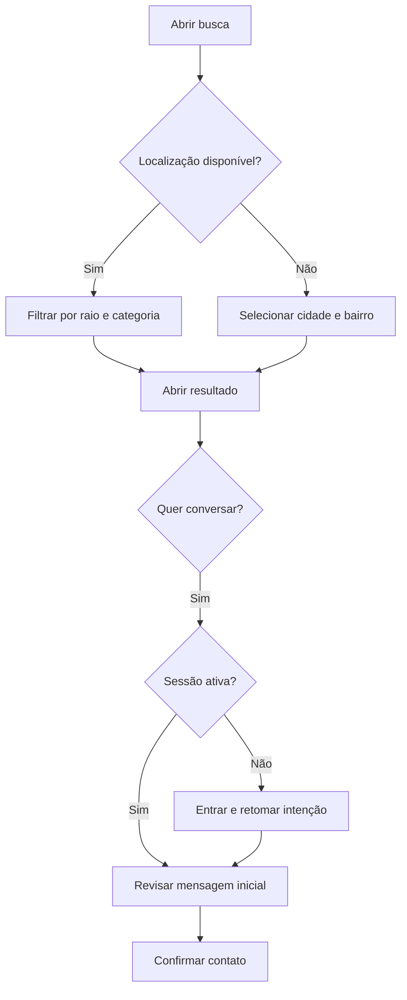

# 03 — Fluxos e estados

## Adaptação ao código — prevalece sobre propostas anteriores
Rotas existentes: /app/inicio, /app/proximos, /app/publicar, /app/perfil, /app/chat e /app/servicos. Preservar compatibilidade ao acrescentar detalhe e conversas por ID. Serviços pendentes/finalizados continuam como acompanhamento separado do estado da publicação. Login local atual é demonstrativo.

Veja AUDITORIA-MAO-DE-OBRA.md para evidências e limites.

> Versão 1.0 • 11/10/2026 • Status: especificação proposta para implementação.
> Base: briefing do marketplace de mão de obra e referência dos seis documentos. O código foi auditado estaticamente no commit c41890ebfe643a5a4eb50499d552ed47acbbcb42; build, TypeScript e Storybook aprovados; lint falhou; produção continua não validada. Decisões adicionais estão identificadas como propostas.

## 1. Navegação
Rotas propostas: / (apresentação), /app/inicio (feed visitante e autenticado), /app/busca, /app/publicar, /app/publicacoes/:id, /app/profissionais/:id, /app/mensagens, /app/mensagens/:id, /app/perfil, /app/configuracoes e /admin/denuncias.
Navegação inferior mobile: Início, Buscar, Publicar, Mensagens e Perfil. A página /app/inicio funciona sem sessão. Publicar e Mensagens apresentam acesso quando necessário.

## 2. Primeiro acesso
1. Abrir feed com região selecionável e publicações públicas.
2. Pedir localização apenas quando usuário toca em “Usar minha localização”.
3. Se negar ou falhar, oferecer cidade e bairro sem bloquear navegação.
4. Ao tentar publicar ou conversar, guardar apenas rota e intenção em estado seguro.
5. Login por e-mail ou Google configurado.
6. Retomar a tela anterior; nunca enviar mensagem ou publicar sem confirmação.
7. Cadastro incompleto abre etapa mínima e depois retorna à intenção.

| Situação | Comportamento |
|---|---|
| Google não configurado | Não oferecer botão funcional falso; e-mail continua disponível |
| OAuth cancelado | Voltar à tela com alternativa de acesso |
| Sessão expirada | Reautenticar e preservar rascunho sem expor dados a outra conta |
| Perfil não encontrado | Tela de criação de perfil; sem loop de redirecionamento |
| Visitante abre link de conversa | Exigir login e depois validar participação |

## 3. Profissional
Escolher “Oferecer serviço” → completar categorias e região → adicionar portfólio opcional → publicar disponibilidade → revisar → confirmar → sucesso → abrir publicação.
Formulário: categoria, título, descrição, datas, área e preço/unidade ou “a combinar”. Validação mantém campos preenchidos. Mudança de unidade não converte valor automaticamente.
Após contato: notificação → conversa → esclarecer escopo → combinar detalhes → serviço tratado entre as partes → profissional encerra ou renova disponibilidade.

## 4. Contratante
Escolher “Preciso de um serviço” → selecionar categoria → descrever necessidade → informar região, data e orçamento → revisar → publicar → receber interessados → abrir perfis e conversar.
Alternativa: busca → filtro por região/categoria → perfil → “Conversar sobre este serviço” → mensagem inicial → confirmação. Contato parte de oferta ativa; perfil sem oferta apresenta opção de buscar outras ofertas no MVP.

## 5. Descoberta e interesse

Se nenhum resultado: limpar filtro, ampliar raio explicitamente ou publicar necessidade. Nunca ampliar raio de forma silenciosa. Sem conexão: preservar filtros e oferecer tentar novamente.

## 6. Estados da publicação
| Estado | Entrada | Saída permitida |
|---|---|---|
| draft | Novo formulário salvo | active após validação ou exclusão |
| active | Autor confirma | paused, closed, expired, removed |
| paused | Autor pausa | active se válida; closed; expired; removed |
| closed | Autor encerra | Estado final; nova publicação por duplicação revisada |
| expired | Data limite passou | Renovação revisada para active; closed; removed |
| removed | Moderador remove | Restauração administrativa para paused após revisão |

Rascunhos são privados. Pausadas/encerradas/expiradas/removidas não aparecem no feed. Histórico do autor mostra status e motivo quando aplicável. Se alguém abre link antigo, informar indisponibilidade; autor ainda acessa gerenciamento.

## 7. Conversa
Estados: aberta, bloqueada para envio, arquivada pelo usuário e somente leitura por suspensão/remoção do contexto. Arquivar muda apenas a visualização de quem arquivou.
Mensagem local: digitando → enviando → enviada; falha permite reenvio com o mesmo clientMessageId. “Enviada” significa persistida; “lida” somente se o destinatário abriu e confirmou leitura. Não inventar status de entrega.
Encerramento de publicação mantém conversa existente aberta para participantes ativos; bloqueio ou suspensão prevalece. Remoção por moderação torna contexto somente leitura. Nenhum visitante acessa conversa pelo ID.

## 8. Bloqueio e denúncia
Menu do conteúdo → denunciar → escolher motivo → enviar → recibo. Denúncia não remove automaticamente; moderador revisa. Bloqueio é ação separada, com confirmação, e impede novos contatos em ambos os sentidos.
Painel administrativo: fila → abrir evidências mínimas → manter/remover/suspender conforme caso → registrar motivo → encerrar denúncia. Revisão de mensagens reportadas deve limitar-se à evidência autorizada; não oferecer consulta irrestrita de conversas.

## 9. Privacidade e conta
Configurações → dados da conta → solicitar exclusão → explicar efeitos → confirmação → protocolo. Processo remove exposição pública, encerra publicações e impede novos contatos. Tratamento de histórico, retenção e exclusão definitiva deve ser definido e revisado antes do lançamento. Não prometer prazo automático não implementado.

## 10. Cenários de aceite
A: negar localização e navegar por Goiânia/bairro.
B: entrar como visitante em /app/inicio sem tela vazia.
C: tentar publicar sem login e retomar formulário após acesso.
D: profissional publica; contratante encontra pela mesma categoria/região.
E: reenviar mensagem após falha sem duplicá-la.
F: bloquear contato e testar envio nas duas direções.
G: expirar publicação e confirmar ausência no feed mesmo antes do job.
H: abrir conversa com terceira conta e receber acesso negado.
I: filtrar preço por diária e não comparar oferta por hora.
J: abrir link removido e receber estado indisponível com saída clara.

